# CHƯƠNG 5: THIẾT KẾ GIAO DIỆN

## 5.1. Danh sách các màn hình và sơ đồ chuyển đổi

Hệ thống được chia làm 2 luồng người dùng chính (Khách hàng và Quản trị viên), phân nhánh từ Màn hình chính và Màn hình đăng nhập.

### 5.1.1. Danh sách các màn hình

**MÀN HÌNH CHÍNH (Trang chủ & Tìm kiếm sản phẩm)**
*   **Màn hình Danh mục & Bộ lọc sách** (Mới thêm)
*   **Màn hình Chi tiết Sản phẩm**
*   **Màn hình Giỏ hàng**
    *   Màn hình Thanh toán và Đặt hàng (Checkout & Purchase)
*   **Màn hình Khách hàng (Hồ sơ cá nhân)**
    *   Màn hình Thông tin cá nhân (Cập nhật thông tin, đổi MK, Avatar)
    *   Màn hình Lịch sử mua hàng
        *   **Màn hình Chi tiết đơn hàng** (Mới thêm)
        *   **Màn hình Đánh giá sản phẩm** (Mới thêm)
*   **Màn hình Đăng nhập**
    *   Màn hình Đăng ký
    *   Màn hình Quên mật khẩu / Đặt lại mật khẩu
    
*   **Bảng điều khiển Admin (Dashboard)**
    *   **Màn hình Bán hàng tại quầy (POS)** (Mới thêm)
    *   **Màn hình Quản lý Danh mục** (Mới thêm)
    *   **Màn hình Quản lý Mã giảm giá (Voucher)** (Mới thêm)
    *   **Màn hình Quản lý Tài khoản** (Thêm, sửa, xóa KH & Nhân viên)
    *   **Màn hình Quản lý Sản phẩm** (Thêm, sửa, xóa sách)
    *   **Màn hình Quản lý Đơn hàng** (Duyệt, Đang giao, Đã giao, Hủy)
    *   **Màn hình Quản lý Kho**
        *   Màn hình Phiếu Nhập hàng
        *   Màn hình Phiếu Kiểm kê

### 5.1.2. Sơ đồ chuyển đổi

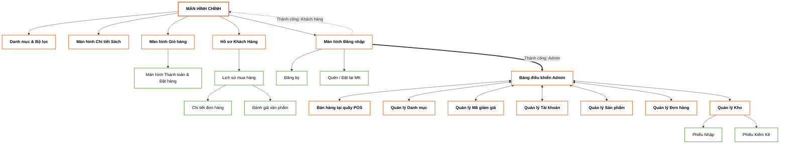

---

## 5.2. Mô tả chi tiết các màn hình

*(Ghi chú: Lần lượt liệt kê từ 5.2.1 đến 5.2.21 bao gồm 7 giao diện mới cập nhật)*

### 5.2.1. Màn hình chính (Trang chủ)
 **Ý nghĩa:** Là màn hình đầu tiên khách hàng tiếp xúc, cho phép khách hàng xem danh sách các sách nổi bật, sách mới và thực hiện tìm kiếm, điều hướng mua sắm.
 **Các đối tượng trong màn hình:**

| STT | Loại | Ý nghĩa |
|---|---|---|
| 1 | button | Chuyển sang màn hình Giỏ hàng |
| 2 | button | Chuyển sang màn hình Đăng nhập (nếu chưa đăng nhập) |
| 3 | textInput | Nhập từ khóa tìm kiếm (Tên sách, tác giả) |
| 4 | button | Thêm nhanh sách tương ứng vào giỏ hàng |
| 5 | gridLayout | Hiển thị danh sách các tựa sách nổi bật |

 **Sơ đồ biến cố:**
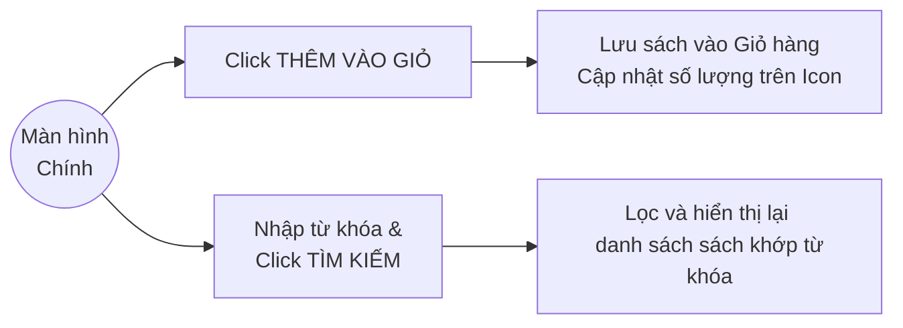

### 5.2.2. Màn hình Chi tiết Sản phẩm
 **Ý nghĩa:** Cho phép khách hàng xem thông tin cụ thể của một cuốn sách (Tên, tác giả, NXB, mô tả nội dung, giá bán, số lượng tồn) trước khi quyết định mua.
 **Các đối tượng trong màn hình:**

| STT | Loại | Ý nghĩa |
|---|---|---|
| 1 | image | Hiển thị ảnh bìa trực quan của sách |
| 2 | text | Hiển thị giá bán, tác giả, mô tả nội dung |
| 3 | button | Chọn số lượng sách muốn thêm vào giỏ (+/-) |
| 4 | button | Thêm sách vào giỏ hàng với số lượng tương ứng |

 **Sơ đồ biến cố:**
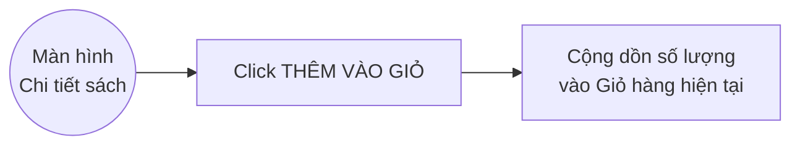

### 5.2.3. Màn hình Giỏ hàng
 **Ý nghĩa:** Hiển thị danh sách các sách khách hàng đã chọn mua, tính toán tổng tiền và cho phép tiến hành thanh toán.
 **Các đối tượng trong màn hình:**

| STT | Loại | Ý nghĩa |
|---|---|---|
| 1 | dataGrid | Hiển thị danh sách sách trong giỏ, đơn giá, tổng phụ |
| 2 | button | Tăng hoặc giảm số lượng sách muốn mua |
| 3 | button | Xóa một tựa sách khỏi giỏ hàng |
| 4 | button | Chuyển sang bước Thanh toán |

 **Sơ đồ biến cố:**
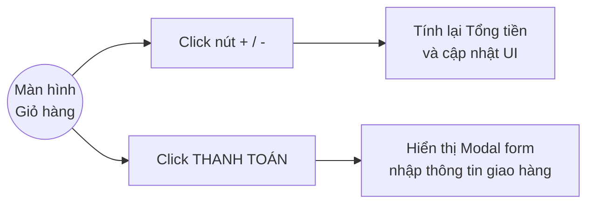

### 5.2.4. Màn hình Thanh toán và Xác nhận đặt hàng (Checkout & Purchase)
 **Ý nghĩa:** Thu thập thông tin giao hàng của khách hàng (Họ tên, SĐT, Địa chỉ), chọn phương thức thanh toán, hiển thị hóa đơn tóm tắt và thực hiện chốt đơn hàng.
 **Các đối tượng trong màn hình:**

| STT | Loại | Ý nghĩa |
|---|---|---|
| 1 | textInput | Nhập Họ tên, Số điện thoại, Địa chỉ giao hàng, Mã giảm giá |
| 2 | radioGroup | Chọn phương thức thanh toán (COD, VietQR, VNPAY) |
| 3 | dataGrid | Liệt kê tóm tắt lại các sách đã chọn và tổng tiền thanh toán |
| 4 | button | Nút Xác nhận Đặt hàng (Purchase) |

 **Sơ đồ biến cố:**
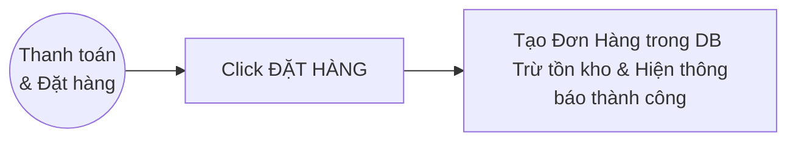

### 5.2.5. Màn hình Đăng nhập
 **Ý nghĩa:** Nơi xác thực danh tính để phân quyền người dùng.
 **Các đối tượng trong màn hình:**

| STT | Loại | Ý nghĩa |
|---|---|---|
| 1 | textInput | Nhập địa chỉ email hoặc tên tài khoản |
| 2 | textInput | Nhập mật khẩu (hiển thị ẩn) |
| 3 | button | Gửi dữ liệu để xác thực vào hệ thống |
| 4 | link | Chuyển sang màn hình Đăng ký hoặc Khôi phục MK |

 **Sơ đồ biến cố:**
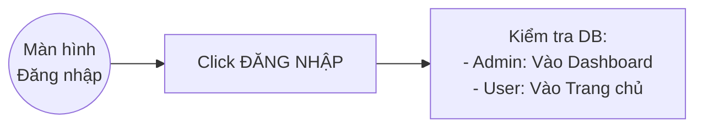

### 5.2.6. Màn hình Đăng ký
 **Ý nghĩa:** Cho phép người dùng mới tạo tài khoản Khách hàng để mua sắm và quản lý đơn hàng.
 **Các đối tượng trong màn hình:**

| STT | Loại | Ý nghĩa |
|---|---|---|
| 1 | textInput | Nhập Họ tên, Email, Mật khẩu, Xác nhận Mật khẩu |
| 2 | button | Gửi yêu cầu tạo tài khoản |

 **Sơ đồ biến cố:**
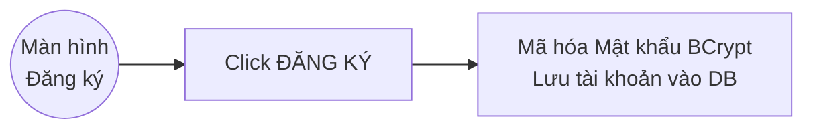

### 5.2.7. Màn hình Quên / Đặt lại mật khẩu
 **Ý nghĩa:** Hỗ trợ người dùng khôi phục mật khẩu khi bị quên thông qua Email/Mã OTP.
 **Các đối tượng trong màn hình:**

| STT | Loại | Ý nghĩa |
|---|---|---|
| 1 | textInput | Nhập Email để nhận mã khôi phục |
| 2 | button | Yêu cầu Gửi mã OTP/Token qua Email |
| 3 | textInput | Nhập Mật khẩu mới (Ở bước Đặt lại) |

 **Sơ đồ biến cố:**
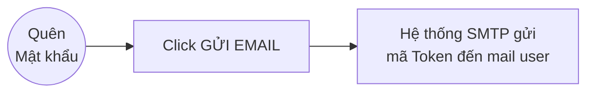

### 5.2.8. Màn hình Hồ sơ Khách hàng & Lịch sử mua
 **Ý nghĩa:** Nơi khách hàng quản lý thông tin cá nhân và theo dõi Lịch sử các đơn hàng đã đặt.
 **Các đối tượng trong màn hình:**

| STT | Loại | Ý nghĩa |
|---|---|---|
| 1 | tabControl | Chuyển tab Thông tin cá nhân và Lịch sử đơn hàng |
| 2 | textInput | Nhập lại Họ tên, SĐT, Địa chỉ mới |
| 3 | dataGrid | Hiển thị trạng thái các đơn hàng đã mua |
| 4 | button | Lưu thay đổi thông tin cá nhân |

 **Sơ đồ biến cố:**
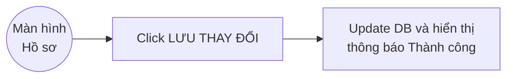

### 5.2.9. Bảng điều khiển Admin (Dashboard)
 **Ý nghĩa:** Báo cáo tổng quan về doanh thu, số lượng đơn hàng, và cảnh báo sách sắp hết tồn kho.
 **Các đối tượng trong màn hình:**

| STT | Loại | Ý nghĩa |
|---|---|---|
| 1 | navBar | Điều hướng đến các chức năng Quản lý |
| 2 | card | Hiển thị số liệu tổng quát (Doanh thu, Đơn hàng) |
| 3 | dataGrid | Liệt kê danh sách các tựa sách sắp hết hàng |

 **Sơ đồ biến cố:**
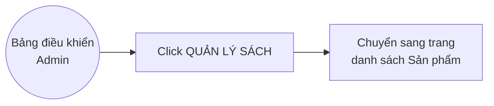

### 5.2.10. Màn hình Quản lý Tài khoản (Admin)
 **Ý nghĩa:** Cho phép Quản trị viên thêm, sửa, xóa, khóa tài khoản của Nhân viên và Khách hàng.
 **Các đối tượng trong màn hình:**

| STT | Loại | Ý nghĩa |
|---|---|---|
| 1 | dataGrid | Hiển thị danh sách tài khoản trong hệ thống |
| 2 | button | Thêm tài khoản mới (Cấp quyền Admin/User) |
| 3 | button | Khóa / Mở khóa tài khoản vi phạm |

 **Sơ đồ biến cố:**
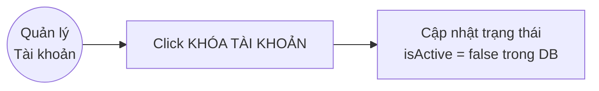

### 5.2.11. Màn hình Quản lý Sản phẩm (Admin)
 **Ý nghĩa:** Cho phép Quản trị viên quản lý kho sách (Thêm, sửa, xóa sách).
 **Các đối tượng trong màn hình:**

| STT | Loại | Ý nghĩa |
|---|---|---|
| 1 | dataGrid | Hiển thị danh sách toàn bộ sách hiện có |
| 2 | button | Mở form/drawer để nhập thông tin sách mới |
| 3 | button | Sửa thông tin / Xóa sách khỏi CSDL |

 **Sơ đồ biến cố:**
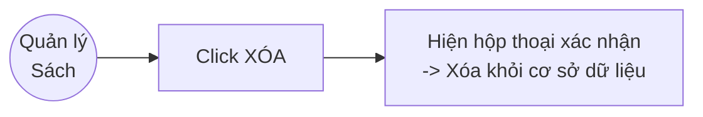

### 5.2.12. Màn hình Quản lý Đơn hàng (Admin)
 **Ý nghĩa:** Theo dõi tất cả đơn đặt hàng và thay đổi trạng thái giao hàng.
 **Các đối tượng trong màn hình:**

| STT | Loại | Ý nghĩa |
|---|---|---|
| 1 | dataGrid | Hiển thị danh sách Đơn hàng |
| 2 | dropDown | Bộ lọc trạng thái: Chờ duyệt, Đang giao... |
| 3 | button | Cập nhật trạng thái của đơn hàng đã chọn |

 **Sơ đồ biến cố:**
```mermaid
graph LR
  Screen((Quản lý <br> Đơn hàng))
  C1[Chọn Trạng thái mới <br> & Click CẬP NHẬT]
  A1[Lưu trạng thái đơn mới <br> (VD: Chờ duyệt -> Đang giao)]
  Screen --> C1 --> A1
```

### 5.2.13. Màn hình Quản lý Kho - Phiếu Nhập (Admin)
 **Ý nghĩa:** Quản lý quy trình nhập sách mới từ Nhà cung cấp vào kho.
 **Các đối tượng trong màn hình:**

| STT | Loại | Ý nghĩa |
|---|---|---|
| 1 | dropDown | Chọn tên Nhà cung cấp sách |
| 2 | dataGrid | Bảng chi tiết các tựa sách nhập, số lượng, giá |
| 3 | button | Lưu tạm phiếu nhập |
| 4 | button | Xác nhận Phiếu nhập (Làm tăng tồn kho thật) |

 **Sơ đồ biến cố:**
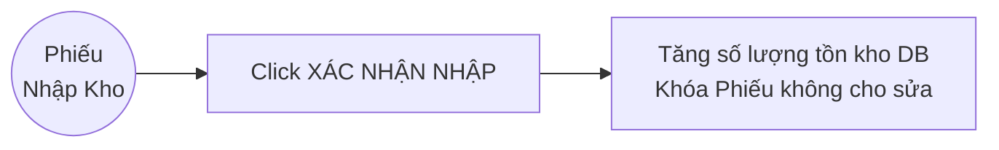

### 5.2.14. Màn hình Quản lý Kho - Phiếu Kiểm Kê (Admin)
 **Ý nghĩa:** Đối soát số lượng sách tồn kho thực tế so với trên hệ thống, xử lý hao hụt.
 **Các đối tượng trong màn hình:**

| STT | Loại | Ý nghĩa |
|---|---|---|
| 1 | dataGrid | Hiển thị Tồn hệ thống và ô nhập Tồn thực tế |
| 2 | textInput | Ghi chú lý do hao hụt |
| 3 | button | Chốt phiếu kiểm kê |

 **Sơ đồ biến cố:**
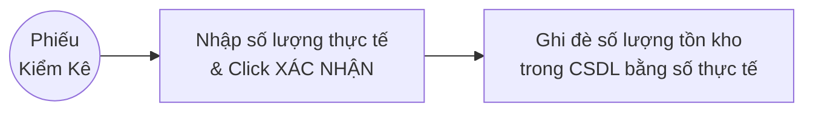

---
*(CÁC GIAO DIỆN BỔ SUNG TỪ MỤC 5.2.15 ĐẾN 5.2.21)*

### 5.2.15. Màn hình Danh Mục & Bộ Lọc Sách
 **Ý nghĩa:** Hỗ trợ Khách hàng tìm kiếm, lọc nhanh sách theo Thể loại, Tác giả, và Khoảng giá mong muốn.
 **Các đối tượng trong màn hình:**

| STT | Loại | Ý nghĩa |
|---|---|---|
| 1 | checkBox | Cho phép tích chọn nhiều Thể loại sách cùng lúc |
| 2 | slider/input | Nhập hoặc kéo thanh trượt để chọn khoảng giá |
| 3 | button | Bấm Áp dụng bộ lọc |
| 4 | gridLayout | Hiển thị lưới sản phẩm đã được lọc |

 **Sơ đồ biến cố:**
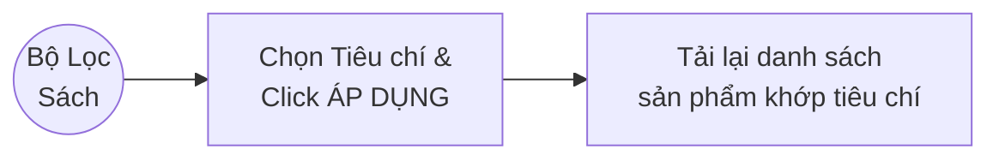


### 5.2.16. Màn hình Chi tiết đơn hàng (User)
 **Ý nghĩa:** Nơi khách hàng theo dõi sát sao tình trạng giao hàng, xem lại số tiền đã thanh toán, và có thể yêu cầu Hủy đơn.
 **Các đối tượng trong màn hình:**

| STT | Loại | Ý nghĩa |
|---|---|---|
| 1 | text | Trạng thái đơn (Đang xử lý, Đang giao...) |
| 2 | table | Bảng danh sách sản phẩm trong mã đơn này |
| 3 | button | Nút Hủy đơn (Chỉ hiện khi chưa giao cho Shipper) |
| 4 | button | Nút Đánh giá (Hiện khi đã nhận hàng thành công) |

 **Sơ đồ biến cố:**
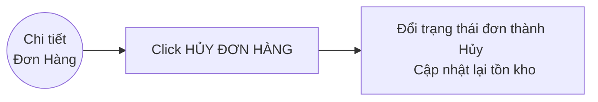

### 5.2.17. Màn hình Đánh giá (Feedback)
 **Ý nghĩa:** Thu thập phản hồi, chấm điểm của khách hàng về cuốn sách họ đã đọc, giúp tăng độ uy tín cho sản phẩm.
 **Các đối tượng trong màn hình:**

| STT | Loại | Ý nghĩa |
|---|---|---|
| 1 | ratingBar | Khách click chọn từ 1 đến 5 sao |
| 2 | textInput | Khung điền bình luận, cảm nhận về sách |
| 3 | button | Bấm Gửi đánh giá lên hệ thống |

 **Sơ đồ biến cố:**
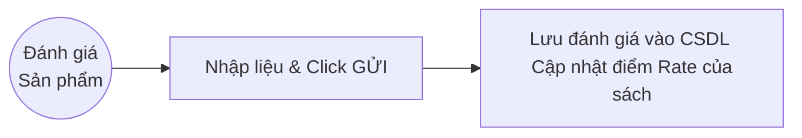

### 5.2.18. Màn hình Trang của POS thu ngân
 **Ý nghĩa:** Dành riêng cho nhân viên tại cửa hàng offline, thao tác bán hàng nhanh, xuất hóa đơn tại quầy.
 **Các đối tượng trong màn hình:**

| STT | Loại | Ý nghĩa |
|---|---|---|
| 1 | searchInput | Nhập hoặc scan barcode mã sách để thêm vào hóa đơn |
| 2 | table | Danh sách các sách khách đang mang tới quầy |
| 3 | textInput | Nhập số tiền khách đưa để tính tiền thối lại |
| 4 | button | Chốt thanh toán và In Hóa Đơn (Print Bill) |

 **Sơ đồ biến cố:**
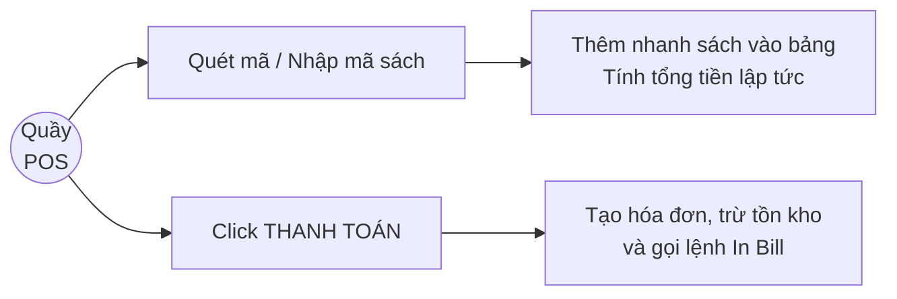

### 5.2.19. Màn hình Quản lý danh mục
 **Ý nghĩa:** Phân hệ Admin để tạo thêm Thể loại sách mới, chỉnh sửa tên Danh mục cũ, giúp tổ chức kho sách khoa học.
 **Các đối tượng trong màn hình:**

| STT | Loại | Ý nghĩa |
|---|---|---|
| 1 | textInput | Form nhập Tên danh mục mới (VD: Khoa học viễn tưởng) |
| 2 | dataGrid | Liệt kê các danh mục hiện hữu trên hệ thống |
| 3 | button | Lưu Danh mục mới / Cập nhật Danh mục |
| 4 | button | Xóa Danh mục (Kèm kiểm tra xem có sách bên trong không) |

 **Sơ đồ biến cố:**
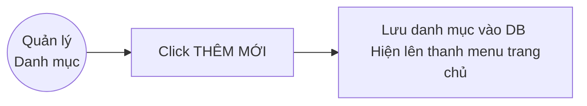

### 5.2.20. Màn hình Quản lý Mã giảm giá (Voucher)
 **Ý nghĩa:** Phân hệ Admin thiết lập các đợt khuyến mãi, mã Voucher cho dịp lễ, kích cầu mua sắm.
 **Các đối tượng trong màn hình:**

| STT | Loại | Ý nghĩa |
|---|---|---|
| 1 | textInput | Nhập Mã Code (VD: TET2024), % Giảm giá, Số lượng |
| 2 | datePicker| Chọn Ngày bắt đầu và Ngày kết thúc chương trình |
| 3 | dataGrid | Liệt kê các Voucher đang Active hoặc Hết hạn |
| 4 | button | Thêm mới mã giảm giá vào hệ thống |

 **Sơ đồ biến cố:**
```mermaid
graph LR
  Screen((Quản lý <br> Voucher))
  C1[Điền thông tin & <br> Click LƯU VOUCHER]
  A1[Voucher khả dụng cho Khách <br> nhập tại bước Thanh Toán]
  Screen --> C1 --> A1
```
